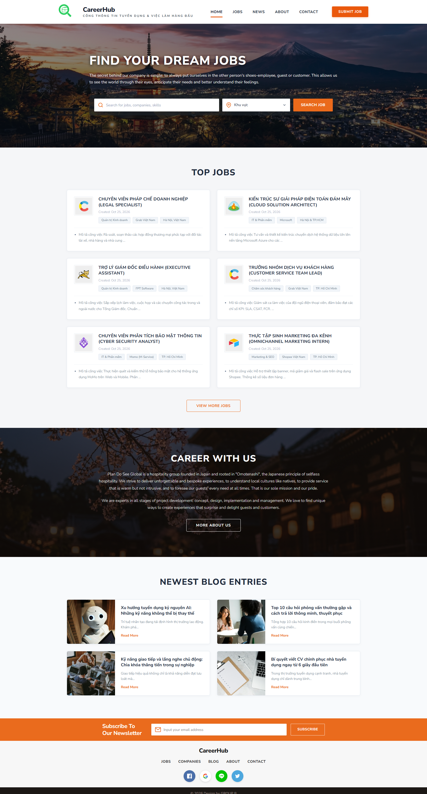
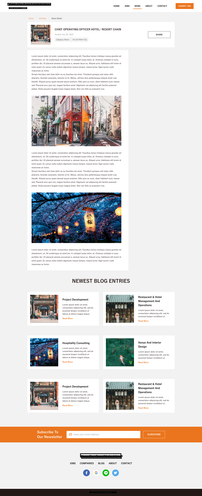

# 🚀 CareerHub - Modern Recruitment & Job Board Platform

<p align="center">
  
  
  
  
  <br />
  
  
  
</p>

> **CMS Capstone Project**  
> An enterprise-grade, fully responsive online job recruitment and employment portal built on top of **WordPress** and containerized using **Docker Desktop & Docker Compose** (WordPress App, MariaDB, and phpMyAdmin).

---

## 📸 Preview

<p align="center">
  <b>🌟 Landing Page Overview</b><br />
  
</p>

<p align="center">
  <b>📰 News & Career Blog Article Detail</b><br />
  
</p>

---

## ✨ Key Features

### 🎯 1. For Job Seekers
- **Smart Job Search & Filtering:** Multi-criteria real-time filtering directly on the Hero banner (by keywords, position, skillsets, and geographical location).
- **Featured Top Jobs:** Curated listings highlighting top career opportunities with rich metadata (salary ranges, contract types, experience levels via *WPJM Extra Fields*).
- **In-Depth Job Details:** Clean layout detailing responsibilities, qualifications, benefits, and application deadlines.
- **Online Job Application:** Seamless CV submission and application forms routed directly to hiring teams.
- **Career Guide & Blog:** Informative articles covering AI-era hiring trends, interview strategies, CV optimization, and workplace communication skills.
- **Newsletter Subscription:** Automated email alerts for new job openings powered by *Newsletter Plugin*.

### 🏢 2. For Employers
- **Job Submission Portal (`Submit Job`):** Intuitive frontend form for publishing vacancies with customizable requirements and rich fields.
- **Employer Dashboard:** Centralized panel to manage active postings, review applicants, and update hiring statuses.
- **Dedicated Company Profiles:** Standalone employer landing pages showcasing company background, culture, and all active vacancies (*WPJM Company Profile Page*).

### ⚙️ 3. Architecture & Tech Highlights
- **Containerized Environment:** Fully reproducible local development powered by Docker Compose.
- **High-Performance Database:** MariaDB 10.11 with persistent volume storage and phpMyAdmin interface.
- **Customizer & Modular Sections:** Native WordPress Customizer controls allowing section reordering, custom styling, and layout tuning without third-party page builders.
- **Responsive & Modular Architecture:** Fluid responsive layout across desktop, tablet, and mobile devices, with modular stylesheets.
- **Guaranteed Email Delivery:** Integrated with *WP Mail SMTP* and *Contact Form 7* for reliable transactional email delivery (applications, notifications, and inquiries).

---

## 🔌 Integrated Plugins & Functional Ecosystem

The portal leverages an optimized, conflict-free suite of WordPress plugins to power core recruitment workflows, audience engagement, and communication reliability:

| Plugin | Version | Author | Role & Key Value in CareerHub |
| :--- | :---: | :--- | :--- |
| **[WP Job Manager](https://wpjobmanager.com/)** | `2.4.8` | Automattic | **Core Recruitment Engine:** Powers job listings, frontend job submissions, AJAX search/filters, and candidate application workflows. |
| **[WPJM Company Profile Page](https://tilcode.blog/)** | `1.3.0` | Gabriel Maldonado | **Employer Branding:** Adds dedicated company profile pages displaying corporate overviews, branding, and all jobs posted by that company. |
| **WPJM Extra Fields** | `1.0.0` | Custom Ext. | **Custom Job Metadata:** Extends job schemas with essential fields (salary ranges, experience requirements, work modes: Remote/Hybrid/Onsite). |
| **[WP Mail SMTP](https://wpmailsmtp.com/)** | `4.10.3` | WP Mail SMTP | **Transactional Email Delivery:** Guarantees application receipts, employer alerts, and system emails reach user inboxes reliably via authenticated SMTP. |
| **[Newsletter](https://www.thenewsletterplugin.com/)** | `9.4.8` | The Newsletter Team | **Subscriber Engagement:** Manages talent communities, subscription widgets, automated email digests, and job opening alerts. |
| **[Contact Form 7](https://contactform7.com/)** | `6.2.2` | Rock Lobster Inc. | **Inquiries & Communication:** Powers clean, flexible contact forms for user support and employer partnership requests. |
| **RaraTheme Companion** | `1.3.5` | RaraTheme | **Theme Functional Modules:** Supplies custom widgets, author boxes, and homepage section controls tailored specifically for the JobScout theme. |
| **RARA One Click Demo Import** | `1.3.5` | RaraTheme | **Demo Onboarding:** Facilitates rapid demo content and widget structure import. |

---

## 📂 Project Structure

```text
JobScout/
├── .env                  # Environment configuration (ports, database credentials)
├── .env.example          # Sample environment variables template
├── docker-compose.yml    # Multi-container orchestration (WordPress, MariaDB, phpMyAdmin)
├── database.sql          # Pre-configured, production-ready SQL database dump
├── docs/                 # Documentation and high-resolution screenshots
│   └── screenshots/
│       ├── careerhub-homepage.png
│       └── news-detail.png
├── docker/
│   └── uploads.ini       # Optimized PHP runtime settings (64MB upload, 256MB memory)
└── wordpress/            # WordPress core & source code (mounted directly into container)
    └── wp-content/
        ├── plugins/      # WP Job Manager, WP Mail SMTP, Newsletter, Contact Form 7...
        └── themes/       # Custom JobScout theme
```

---

## 🛠️ Quick Start & Installation

### Prerequisites
- Install and launch **[Docker Desktop](https://www.docker.com/products/docker-desktop/)** (Supports Windows WSL2, macOS, and Linux).
- Git installed on your local machine.

---

### Step 1: Map Local Domain (Recommended)
To support WordPress permalinks and internal routing seamlessly, map the project domain to your local loopback address:

- **Windows:** Open `C:\Windows\System32\drivers\etc\hosts` with Administrator privileges.
- **macOS / Linux:** Run `sudo nano /etc/hosts` in your terminal.

Add the following line to the file and save:
```text
127.0.0.1 wordpress.local
```

---

### Step 2: Configure Environment Variables
Copy `.env.example` to create your local `.env` file:

```bash
# Windows PowerShell
Copy-Item .env.example .env

# macOS / Linux
cp .env.example .env
```
*(Default settings configure `WP_PORT=80`, `PMA_PORT=8081`, and pre-configured MariaDB credentials).*

---

### Step 3: Spin Up Containers
Launch the Docker stack in detached mode:

```bash
docker compose up -d
```
> The startup sequence will build the internal bridge network and launch `wordpress_db`, `wordpress_app`, and `wordpress_pma`.

---

### Step 4: Import Sample Database
Once the database container reports **healthy**, import the pre-configured dataset:

```bash
# Windows PowerShell / CMD:
cmd /c "docker exec -i wordpress_db mariadb -u wp_user -pwp_user_password cms-cuoiky < database.sql"

# macOS / Linux:
docker exec -i wordpress_db mariadb -u wp_user -pwp_user_password cms-cuoiky < database.sql
```

---

## 🌐 Access Endpoints

| Service | URL | Notes |
| :--- | :--- | :--- |
| **CareerHub Web Portal** | [http://wordpress.local](http://wordpress.local) | Primary public website |
| **WordPress Admin Panel** | [http://wordpress.local/wp-admin](http://wordpress.local/wp-admin) | Administrative management portal |
| **phpMyAdmin** | [http://localhost:8081](http://localhost:8081) | Web-based database management |

---

## 🔑 Default Credentials

### 1. WordPress Admin Dashboard
- **Login URL:** `http://wordpress.local/wp-login.php`
- **Username:** `root`
- **Password:** `admin123`

### 2. Demo User Accounts (Role Testing)
| Role | Username | Password | Permissions |
| :--- | :--- | :--- | :--- |
| **Employer** | `employer_demo` | `demo123` | Post jobs, manage listings, view applicants |
| **Job Seeker** | `jobseeker_demo` | `demo123` | Search listings, save jobs, submit applications |

### 3. phpMyAdmin Database Access
- **Host / Server:** `db`
- **Root Account:** `root` / `root_secret_password`
- **Application User:** `wp_user` / `wp_user_password`
- **Database Name:** `cms-cuoiky`

---

## 💻 Common Management Commands

```bash
# Check container status
docker compose ps

# View live WordPress application logs
docker compose logs -f wordpress

# Gracefully stop all services
docker compose down

# Restart the entire stack
docker compose restart

# Export latest database changes to database.sql
cmd /c "docker exec wordpress_db mariadb-dump -u wp_user -pwp_user_password cms-cuoiky > database.sql"

# Wipe database volume completely to reset from scratch
docker compose down -v
```

---

## 👥 Authors & Team Contributors

This capstone project was collaboratively designed, developed, and tested by:

| Full Name | Role & Core Responsibilities | GitHub Profile |
| :--- | :--- | :--- |
| **Nguyễn Nhân Bảo** | Project Lead, Auth & Roles, Job Submission & Profile Flow, Docker Architecture | [@nhanbaoit](https://github.com/nhanbaoit) |
| **Đặng Văn Hà** | News/Blog Detail & Listing Layouts, Sortable Sections, Database Optimization | [@DVHorizon](https://github.com/DVHorizon) |
| **Thu Trang** | Homepage UI/UX Refinements, Contact Forms & Page Workflows | Team Contributor |

---

## 📄 License
This project is developed for educational purposes as part of the Content Management System (CMS) capstone curriculum.
